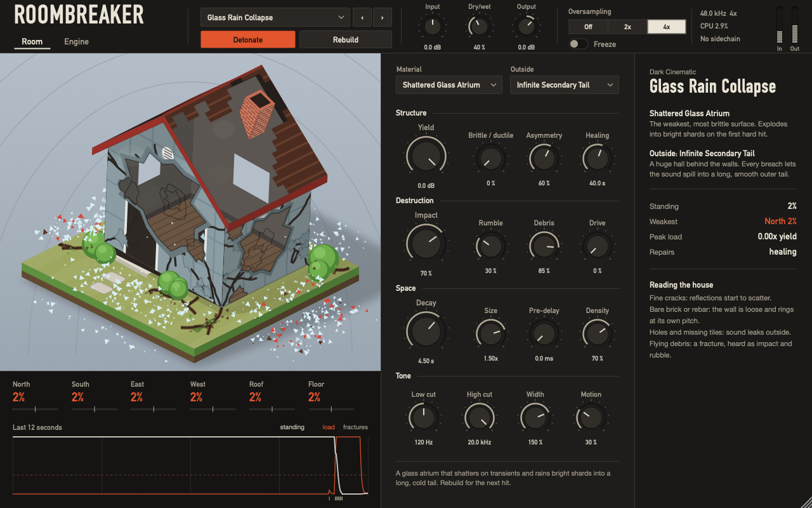
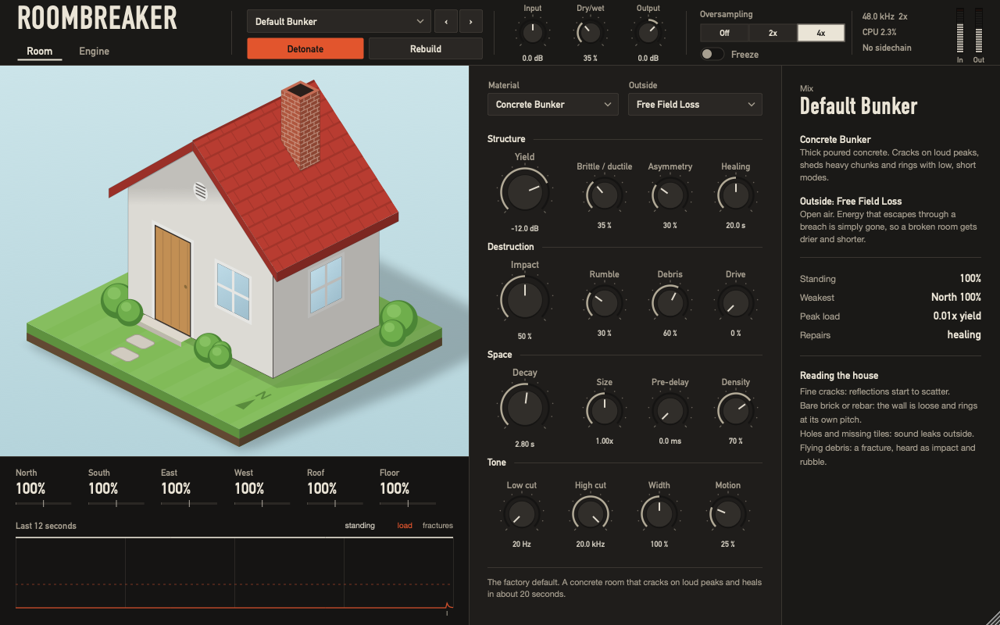
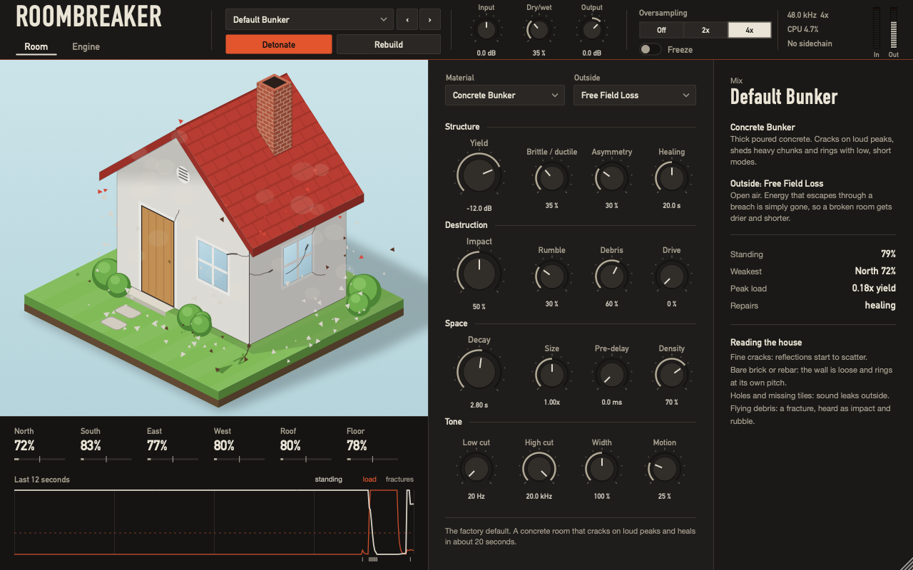
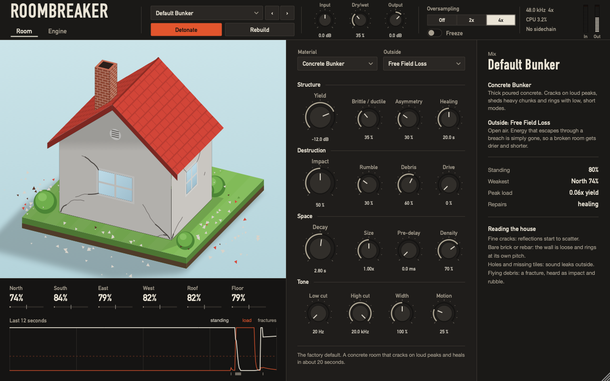

# RoomBreaker

A reverb whose room falls apart. Loud, low and sustained audio puts stress on six surfaces (four
walls, ceiling, floor). They crack, loosen and breach. The tail gets rougher, then leaks into
whatever is outside. When things go quiet, the room heals, unless you turn healing off.

VST3 and Standalone on Windows and macOS, plus AU on macOS. Built with JUCE 8.



## The house

The room is drawn as a small cottage on a patch of lawn, and the picture follows the sound:

- **Walls** (North, South, East, West) crack from the window and door corners. The render falls away
  to show the material underneath, holes open onto the inside of the house, and the glass breaks.
- **Roof** (the ceiling) loses tiles, opens to the rafters, and the chimney leans and then falls.
- **Lawn** (the floor) splits, and the house settles off level.
- Fractures throw debris that lands and stays until the room heals.

Drag to turn the house and double-click to face it again. Hover a wall to read its integrity and load.

| Pristine | Detonated | From behind |
|---|---|---|
|  |  |  |

## Features

- 11 materials (concrete, ceramic, silo …) that set how the room sounds, how it breaks and what the
  walls look like. 7 outside spaces set what you hear and see through a breach.
- Detonate and Rebuild buttons, Freeze, and permadeath.
- Sidechain input, so another track can break the room.
- 1x / 2x / 4x oversampling, which switches without clicks.
- Every control can be automated without clicks.
- A safety limiter and ducking.
- 28 factory presets.
- An info column that explains whatever the mouse is over.

## Download

Every push to `main` builds on GitHub Actions. Open the latest run under **Actions → Build** and
download:

- `RoomBreaker-Windows`: `RoomBreaker.vst3`, `RoomBreaker.exe` (standalone) and install notes.
- `RoomBreaker-macOS`: `RoomBreaker.vst3`, `RoomBreaker.component` (AU) and `RoomBreaker.app`.

### Windows install

Copy `RoomBreaker.vst3` to `C:\Program Files\Common Files\VST3\`, then rescan plugins in your DAW.
See [docs/INSTALL-Windows.txt](docs/INSTALL-Windows.txt).

### macOS install

Copy `RoomBreaker.component` to `~/Library/Audio/Plug-Ins/Components/` and `RoomBreaker.vst3` to
`~/Library/Audio/Plug-Ins/VST3/`. The builds are ad-hoc signed, not notarised, so you may need to
clear the quarantine flag:

```bash
xattr -dr com.apple.quarantine ~/Library/Audio/Plug-Ins/Components/RoomBreaker.component ~/Library/Audio/Plug-Ins/VST3/RoomBreaker.vst3
```

## Build from source

Requires CMake 3.22+ and a C++20 compiler (Visual Studio 2022, Xcode 15+ or recent Clang/GCC). JUCE
8.0.4 is fetched automatically.

```bash
cmake -S . -B build -DCMAKE_BUILD_TYPE=Release
cmake --build build --config Release --parallel
ctest --test-dir build -C Release --output-on-failure
```

Plugins land in `build/RoomBreaker_artefacts/Release/`. `-DRB_CORE_ONLY=ON` builds only the
JUCE-free DSP core and its test harness.

## Tests

- `rb_offline_render` drives the DSP core through scripted scenarios. It covers silence,
  fatigue, healing and permadeath, block-size independence and telemetry threading. It also jumps
  every control mid-signal to check for clicks and runs a 40 s parameter fuzz.
- `rb_plugin_smoke` loads the real plugin headless. It covers buses, state, every preset,
  Detonate, Freeze, the limiter, oversampling switches and the sidechain. It also renders the
  editor snapshots above.

See [ARCHITECTURE.md](ARCHITECTURE.md) for the signal flow, engines, parameters and design rules.

## Status

Built and tested on macOS (Apple Silicon). The AU passes `auval -strict`. The Windows build is
verified by CI only. It has not been tested in a DAW on Windows yet, and the plugins are unsigned.
